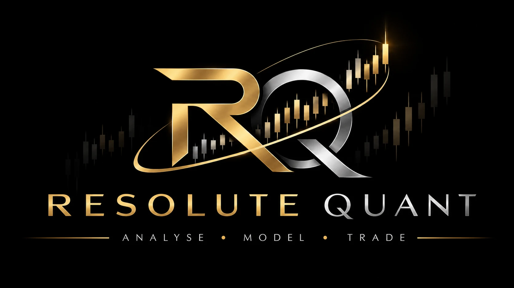
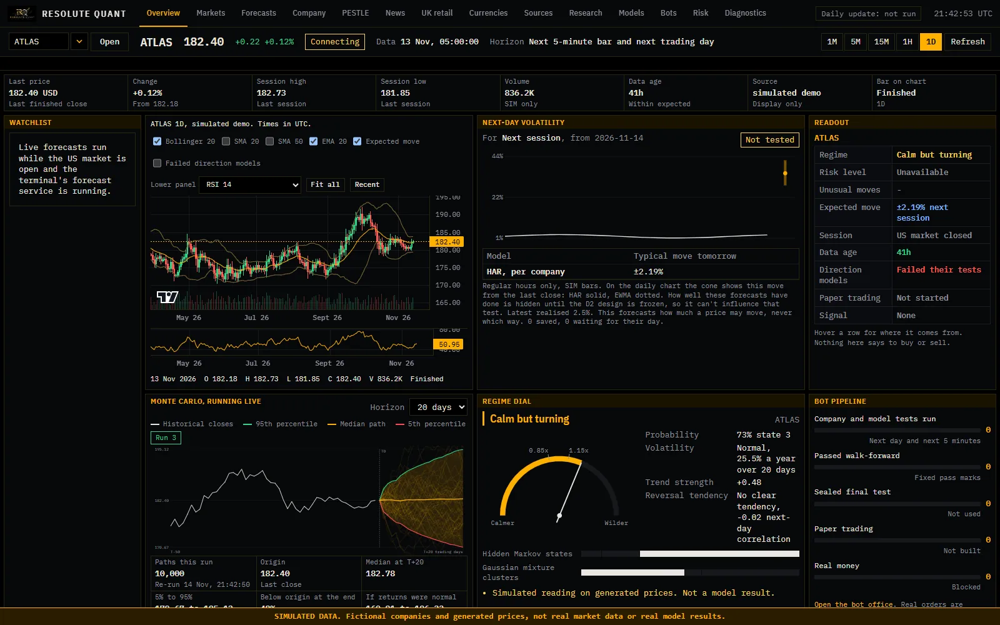
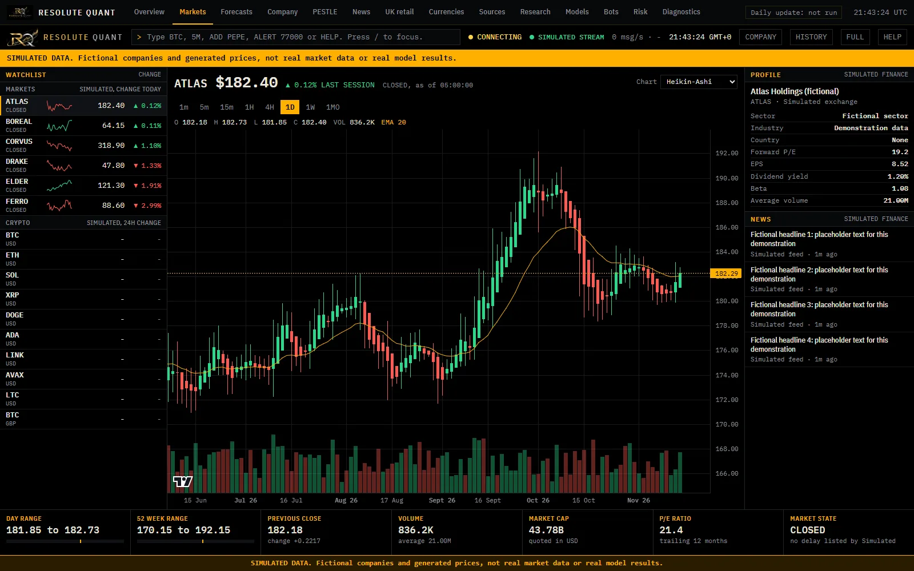
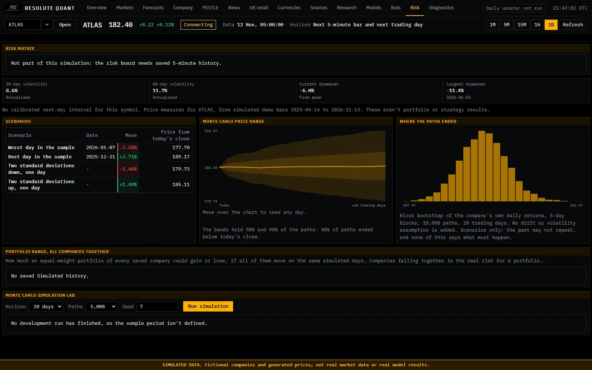
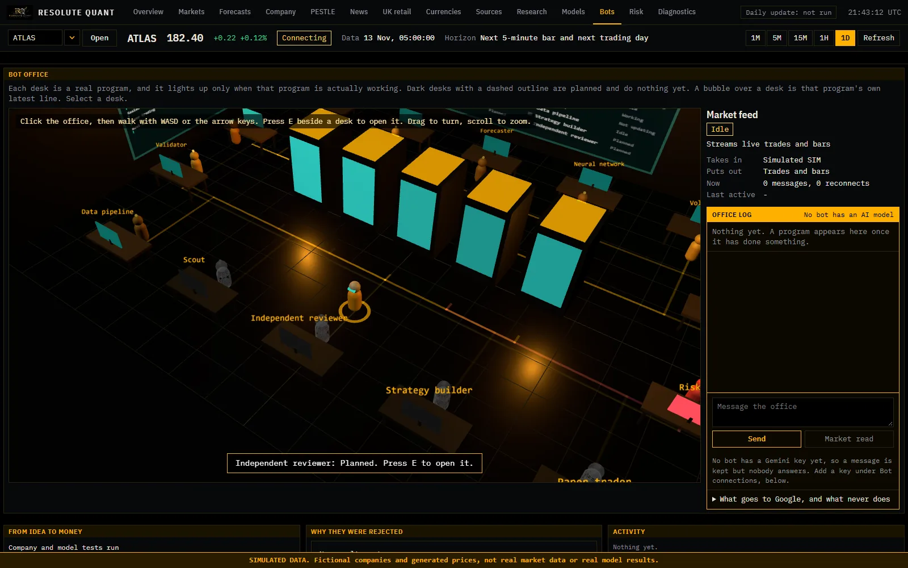

# Resolute Quant

© 2026 RESOLUTE QUANT | SG | subashgauchan16. See [LICENSE](LICENSE). This is proprietary, restricted-use software: public visibility grants no right to use it.

**Project site:** https://subashgauchan16.github.io/Resolute-Quant/ is a summary page. The terminal itself runs on your own computer, and the site shows no market data.

> **Prototype.** A working research terminal with backend-only market data and a research workspace. Five forecasting experiments have been run and none passed its pre-set tests, so no model is in use. It places no orders. The logo's word "trade" is branding; this program has no execution layer.

## Why Resolute

**Resolute** (adjective): determined. Firm in purpose, and patient while the work takes time.

**Resoluter** (noun, my own word): someone who is resolute, a person who decides, stays patient and follows through.

Resoluter isn't in any dictionary. I coined it for Resoluters, the clothing brand I started when I was about 16.
It described who I was then, and it's the attitude this project needs now:

- **Decide first.** Questions and pass marks are written down before any results exist, so they can't be bent to fit.
- **Stay patient.** Honest evidence takes months, and no test is skipped to get there sooner.
- **Follow through.** Failures are recorded with the results, and "no edge found" counts as an honest answer.

## What it is

A local research and monitoring terminal for crypto, stocks, indices, FX and gold.
It places no orders and connects to no broker or exchange account. See `README.txt` for
the short user guide.

## Built since: the research workspace

The workspace and the research code are kept in a private repository for now, because they work with data whose terms allow private research only. This repository holds the earlier terminal.

*These screenshots run the terminal's own backend code on prices generated from a seeded random walk, for fictional companies. Panels that need saved research results show invented placeholders, or say they are unavailable, and a banner marks every screen. None of it is real market data or a real model result.*



**The workspace overview.** One company at a time. The readout table says where it stands (regime, risk level, expected move, data age, model status), and its signal row stays empty until a model passes every gate. Around it: the chart with Bollinger bands, moving averages and RSI, next-day volatility (a size, never a direction), a Monte Carlo fan re-run as the price moves, the regime dial (labelled unproven) and the bot pipeline, where real money is blocked.



**Chart styles.** A menu above the price chart redraws the same bars as candles, hollow candles, Heikin-Ashi, OHLC bars, a line or an area. The legend always shows the real bar under the cursor, because Heikin-Ashi draws averaged prices.



**Risk and scenarios.** The worst and best day in the sample, two-standard-deviation moves, and a block bootstrap of the company's own returns (10,000 paths of 5-day blocks over 20 trading days), with the spread of where the paths ended.



**The bot office.** Each desk is one program and lights up only when that program is working. Planned desks are dark and do nothing yet. Below the office are the gates every bot must pass and the safety controls.

## The models, step by step

The research uses daily and 5-minute bars for 41 large US companies from Alpaca's IEX feed, for private research only. The data terms do not allow figures derived from that data to be published, so this section gives the method and the verdict for each model, not the scores. None of the results has been independently reviewed yet.

**Every model goes through the same eight steps:**

1. **Write the question down.** One target and one horizon, before any data is read for it.
2. **Fix the pass marks.** The benchmarks to beat, the statistical bar and the costs are set in code before the run, and never changed after.
3. **Seal the final period.** The latest data is locked away. A guard stops any run whose dates would reach it.
4. **Build features that can't see the future.** A test changes future prices and checks that no earlier row changes.
5. **Walk forward in time order.** Train on the past, test on the next block, and leave a gap so the two never overlap.
6. **Beat simple rules after costs.** "No change", the past average and similar rules are the bar. Spread, slippage and fees are taken off, and the test is repeated at double cost.
7. **Count every attempt.** Each variant tried is recorded, so a lucky one can't be picked quietly.
8. **Check the checker.** On invented markets, the test must find nothing where nothing exists, and find an edge that was planted on purpose.

A model that passes all eight then faces the sealed period once, then a forward record of forecasts saved before the day, then at least 50 days of paper trading. Real money stays blocked after that, until a separate review.

| # | Model | Question | Method | Verdict |
|---|---|---|---|---|
| 1 | Next-day direction | Will tomorrow's price be higher or lower? | Twelve features (recent returns, volatility, trend, momentum, volume). LightGBM, XGBoost, CatBoost and a small neural network against no change, the past average, the last return and ridge regression. Pass mark: beat every benchmark after costs, walk-forward t-statistic of at least 2.5. | Failed: no edge found |
| 2 | Next 5-minute bar | The same question for the next 5-minute bar | The same models on 5-minute bars, with the last fifth sealed and split conformal prediction intervals. Pass mark: lower error than every benchmark and t of at least 3 on daily averages. | Failed: worse than no change |
| 3 | Market regime | Is the market calm, normal or stressed? | A Gaussian hidden Markov model and a Gaussian mixture on daily return, 20-day volatility and 20-day trend. States chosen by BIC; live readings use only data up to the latest bar. Judged as a volatility forecast against simple rules. | Failed: kept on screen, marked unproven |
| 4 | Next-day volatility | How much will the price move tomorrow, either way? | HAR regression on realised variance from 5-minute bars, per company and pooled, against last value, past average, 20-day average and EWMA. Pass mark: lower QLIKE and squared error than every benchmark, Newey-West t of at least 3. | Failed: beat the rules, missed the t mark |
| 5 | Take-profit or stop | Within the next hour, is a profit target or a stop hit first? | Triple-barrier label (up 2 ATR or down 1 ATR within 12 five-minute bars). LightGBM, CatBoost and a 1D convolutional network, walked forward by whole sessions with purging and an embargo. Five pass marks, including double cost. | Failed: no model passed |
| 6 | Five-day volatility (main test) | How much will the price move over the next week? | Pooled log-HAR, LightGBM and a blend of EWMA and HAR, all against EWMA. Past-data comparison run; the blend chosen as the candidate. The real test is 78 weeks of forecasts saved before each week. | Not started: design not yet frozen |

**Tools that describe risk, not forecast it:**

- **Monte Carlo.** Five ways to simulate a company: day-by-day bootstrap, 5-day blocks, normal, Student t and regime-based. A portfolio version simulates all companies together, and a forward record of its ranges started in November 2026.
- **Risk board.** A likelihood-by-impact matrix with fixed cut points, a flag for unusual moves, and correlation heatmaps.
- **Paper trading simulator.** Built and tested on invented prices only: limits on position size, order value and total exposure, a 5% one-bar loss stop, a 3% daily loss limit, a 10% drawdown limit and a kill switch. It is not connected to any broker or bot.
- **Forensic checks.** Separate tests on invented markets. They found one design fault: the convolutional network could not tell how recent a move was, so its result is not counted as evidence.

## Run it

Double-click `Start Terminal.bat`, then use the page it opens. Keep the black window open, and
close it to stop. The page must come from the data program: opening `terminal.html` directly
cannot load its modules.

## Choosing the port

The first of these that is set wins:

1. `Start Terminal.bat --port 8770`
2. The `RESOLUTE_QUANT_PORT` environment variable
3. `terminal.config.json` beside `server.py`, containing `{"port": 8770}`
4. The default, 8765

- **A configured port (1 to 3) never falls back.** If it is busy, the program says so and stops.
- **The default may fall back.** If 8765 is busy, the program tries 8766 to 8775 in order, and
  says which port it chose in the black window and the page footer.
- **Another program on the port is never touched.** The program reports it and suggests how to identify it.
- **A terminal already running is reused**, not duplicated. `/api/health` confirms its identity.
- **An out-of-date terminal is not reused.** After an update, the launcher asks you to close the old black window and start again, and the page shows the same instruction.
- **Saved settings belong to the exact address.** Watchlists and alerts on one port do not appear
  on another. Keep to one port to keep your settings. They are not migrated automatically.

## Layout

| Layer | Files | Rule |
| --- | --- | --- |
| Data program | `server.py`, `crypto_feed.py` | The only code that talks to providers. Validates data, and serves HTTP, Server-Sent Events and the page's files |
| Data layer | `assets/js/data/` | Calls the data program only. No DOM. Reports news through `store/events.js` |
| State | `assets/js/store/` | Session state, event bus, `localStorage` access, saved layout |
| Model layer | `assets/js/chart/indicators.js` | Pure indicator maths |
| Charts | `assets/js/chart/` | Chart creation, the price panel, order book and tape painting, formatting helpers |
| UI | `assets/js/ui/`, `assets/css/style.css`, `terminal.html` | Panels, command bar, alerts, badges |
| Bootstrap | `assets/js/main.js` | Connects the layers and runs the 200 ms repaint loop |

There is no execution layer. Google Fonts is the only other internet request the page makes.

Lightweight Charts 4.2.0 is vendored in `assets/lib/`. It is Apache 2.0, copyright TradingView, Inc.
(https://www.tradingview.com/). The chart's attribution logo is kept on.

## API

`GET` only, and local requests only. Quote and tick `time` is epoch milliseconds, and candle `time` is epoch seconds.

| Route | Answer |
| --- | --- |
| `/api/health` | `{service, status, timestamp, instance, started, codeId, restartNeeded, port, preferredPort, portSource, fallback, clients, providers}` |
| `/api/stream` | Server-Sent Events: `s` Yahoo status, `q` Yahoo quote, `ct` crypto tick, `cb` top of book, `cs` crypto feed status |
| `/api/watch?symbols=` | Set the Yahoo watchlist. `{quotes, status}` |
| `/api/candles?symbol=&interval=` | Yahoo bars. `1M 5M 15M 1H 4H 1D 1W 1MO`, where `1M` is one minute and `1MO` one month. `{bars, stale}` |
| `/api/profile`, `/api/news`, `/api/resolve` | Yahoo company data |
| `/api/crypto/watch?symbols=` | Set the crypto tickers. `{watch, status}` |
| `/api/crypto/book?symbol=` | Choose the one book to follow; empty stops it. `{symbol}` |
| `/api/crypto/candles?symbol=&granularity=` | Coinbase bars at 60, 300, 900, 3600, 21600 or 86400 seconds. `{bars, stale}` |
| `/api/crypto/stats?symbol=` | `{last, open, high, low, volume, stale}` |
| `/api/sentiment/feargreed` | `{value, classification, time, stale}` |
| `/api/history?symbol=&interval=&source=&start=&end=` | Past bars, newest first, with coverage facts. `source` is `coinbase` or `yahoo`, and dates are UTC `YYYY-MM-DD`. Add `&format=csv` for a CSV file |

`stale: true` means the provider refused and this is the last good copy. Errors are `{error}` with
status 400, 403, 404, 429 or 502. Bad provider values are dropped and counted, never repaired.

## Tests

```bash
python -m unittest discover -s tests
```

```bash
node tests/acceptance.mjs --python .venv/Scripts/python.exe --port 8771 --idle-minutes 10 --out result.json
```

```bash
python tests/launcher_check.py <empty-folder> <output.json> 8801
```

The last two use live providers. They need Edge and an internet connection, and they exit with a failure code if any check fails. The port `8801` keeps the launcher test away from a terminal you already have running.

Dependencies are pinned in `requirements.txt` for repeatable installs, tested on Python 3.13. The packages the project uses directly are listed in `requirements.in`. To update, install from `requirements.in` into a clean environment, retest, then freeze the versions into `requirements.txt`.

## History and CSV export

Press **HISTORY**, or type `HISTORY`, to see past bars for the open symbol. Choose a timeframe and UTC dates, and read the bars newest first. **Export CSV** saves the same rows.

CSV columns: `time_utc, symbol, interval, open, high, low, close, volume, source, downloaded_at_utc`. Times are UTC. Yahoo prices are unadjusted, and a Yahoo daily bar's time is midnight in the exchange's own timezone, so it often shows a non-zero UTC hour.

- Up to 5,000 bars per request. If a range holds more, the newest are returned and the page says so.
- Missing bars are reported and never filled. Invalid rows and the bar still in progress are left out and counted.
- For Yahoo, gaps are counted only inside a trading day, so a whole missing day is not detected. A missing volume stays blank, and negative prices are kept because futures can trade below zero.
- Export checks every row against the table first, and refuses if the data has changed since it was loaded.
- History is fetched from the provider when requested and cached briefly. Only the files you export are kept.
- Exports are for your own use. Do not share them or publish anything derived from them. Coinbase's terms also bar using its data to build or test models without written consent. See `docs/architecture/phase-0-audit.md`.

## Saved in the browser

`localStorage` keys start with `subash.`: `mlist` and `list` (watchlists), `sel`, `gran`,
`alerts` and `layout`.

## Known limits

- One watchlist and one followed book per data program, so two tabs on different symbols compete.
- Each watchlist group holds up to 40 symbols. Adding more is refused with a message.
- Coinbase's newest candle can lag by minutes, so a page load can show a short gap before the live bars.
  A live bar opens at the first trade seen, so its open may differ from the exchange's.
- Yahoo's history is cut to the newest 320 bars per request, and Yahoo data is for personal use and may be delayed.

Saved settings keep the internal `subash.` key prefix from the project's earlier name, so existing watchlists survive the rename.

Stage 1.1 evidence and the research specification are in `docs/sprint-1.1/`. The project site's source is in `site/`, and only that folder is published.
