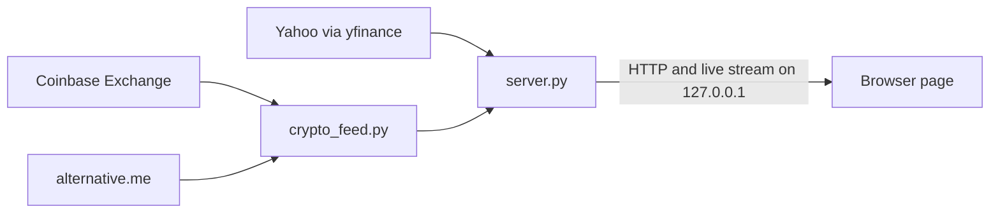
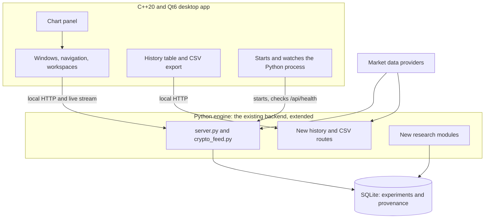

# Resolute Quant: Phase 0 architecture audit

**Date:** 6 November 2026. **Code audited:** `main` at commit `1bee501`. **No application code was changed for this audit.**

Labels: **[Verified]** I checked it directly. **[Reading]** I read the code but did not exercise it. **[Unknown]** I could not establish it.

## Summary

- **What exists:** a working, tested, browser-based terminal with a Python backend. No C++ or Qt code exists.
- **Recommendation:** keep the Python backend and put a Qt6 desktop app in front of it, talking over the local HTTP connection that already exists. Very little Python needs rewriting.
- **Historical data and CSV export do not exist yet.** The current API only returns about the newest 320 to 350 bars. I recommend building this first in the backend, because both the current page and the future Qt app can then use it.
- **Licence constraints found:** Fincept Terminal is AGPL or paid, so its code must not be copied. Qt Charts and Qt Graphs are not available under Qt's free LGPL licence. Both affect the design.
- **Research blocker unchanged:** no dataset exists that is cleared for model work, and this brief's goal of predicting stock returns adds a new data licensing question.
- **Before native work:** this PC has no C++ compiler, CMake or Qt. Installing them needs your approval.

## 1. Verified codebase inventory

| Area | Files | Lines | What it does |
| --- | --- | --- | --- |
| Backend | `server.py` | 628 | Local web server, Yahoo data, port handling, health check, live stream |
| Crypto and sentiment | `crypto_feed.py` | 339 | Coinbase feed, validation, order book, Fear & Greed |
| Terminal page | `terminal.html`, `assets/js/` (23 modules), `assets/css/` | About 1,300 of JavaScript | The current interface |
| Project website | `site/`, `.github/workflows/deploy-pages.yml` | 245 | The public summary page. Separate from the terminal |
| Tests | `tests/` | 934 | Unit, launcher and full-browser tests, plus a memory trend tool |
| Research | `research/` | 191 | Two small provider probes. No models |
| Launcher | `Start Terminal.bat` | 31 | Builds `.venv`, installs dependencies, starts the backend |

**Corrections to the brief:**

| The brief says | What I found |
| --- | --- |
| "Python and JavaScript tests" | There are Python tests and a Node browser test script. **No JavaScript unit tests exist** |
| The site is the "portfolio page" | It is the project site. The portfolio is a separate repository |
| "Integrate existing regression experiments" | **None are in this repository.** A Ridge study is described in your portfolio, and its source code and results are unverified here |

**Which copy to use:** the folder `Downloads/SubashTerminal/Subash Terminal` is an older copy. Its `README.md` differs, and it lacks the licence and `site/`. Use the `Resolute-Quant` clone.

**API routes [Verified]:** `/api/health`, `/api/stream`, `/api/watch`, `/api/candles`, `/api/profile`, `/api/news`, `/api/resolve`, `/api/crypto/watch`, `/api/crypto/book`, `/api/crypto/candles`, `/api/crypto/stats`, `/api/sentiment/feargreed`, `/assets/*`. All are GET requests.

### Test results on this commit

| Suite | Result | Notes |
| --- | --- | --- |
| Backend unit tests | **31 of 31 pass** | |
| Browser test, no idle period | **46 of 46 pass** | Real providers, fresh browser profile, no provider connections from the page |
| Launcher, first run | **1 of 8 pass: invalid run** | You had a real terminal running on port 8766, so the test attached to it. It was not an app failure |
| Launcher, valid rerun | **6 of 8 pass, 2 failed** | Throwaway copy on spare ports, leaving your terminal alone. See below |
| Browser opening, separate diagnostic | **6 of 6 opened** | Took up to 6.8 s from launch, with CPU around 50% |
| 10-minute idle | **Not run for this audit** | Last run had 2 open failures: frame gaps, and a memory limit |
| Real launch by you | **Worked [Verified]** | Started at 13:13 UTC on port 8766, status `ok`, using the announced fallback |

**The 2 launcher failures:** the server started, but no browser launch was recorded within the test's fixed 4-second window. The likely cause is that window being too short on a busy PC, because the diagnostic above opened every time and the same test passed 8 of 8 on two earlier runs. That is likely, not proven. The launcher test should poll rather than use a fixed wait.

**Limit on this evidence:** one Windows PC only, which was busy with other programs during testing.

## 2. Current versus planned features

| Feature | Status | Evidence or note |
| --- | --- | --- |
| Live crypto quotes, book and tape | **Working** | Browser test |
| Stock, index and FX quotes, profile and news | **Working** | Browser test |
| Candlestick chart, volume and EMA 20 | **Working** | Browser test |
| Alerts, watchlist editing, keyboard commands | **Working** | Alert firing was tested with an injected crossing only |
| Offline state and recovery | **Working** | Browser test |
| Port selection and fallback | **Working** | Launcher test; your real launch |
| **Historical data view** | **Missing** | Only the newest 320 to 350 bars, with no date range |
| **CSV export** | **Missing** | No export code exists anywhere |
| Multiple charts, resizable panels | **Missing** | `store/layout.js` saves layouts, but nothing uses it |
| Indicators beyond EMA 20 | **Missing** | |
| Native C++20 and Qt6 app | **Missing** | No C++ exists |
| Research database (SQLite) | **Missing** | |
| Experiments, baselines, models, backtests | **Missing** | No model has ever been trained in this repository |
| Strategy automation, agent bots | **Missing** | Far-future plan only |
| Order execution | **Does not exist** | None is planned in this brief |

## 3. Architecture diagrams

### Today

### Proposed

The dependency runs one way: Qt knows the API, and Python knows nothing about Qt. So the current browser page can keep working throughout the migration, as a fallback and a test tool.

## 4. Reusable Python components

| Component | Reuse | Change needed |
| --- | --- | --- |
| Validation: `normalise_ticker`, `normalise_candles`, `normalise_stats`, `normalise_fear_greed` | **As is** | None. Already unit tested |
| `CoinbaseFeed`, `Book` | **As is** | None |
| `Rest` | **As is, then extend** | Add date-range requests for history |
| `Yahoo` throttle and backoff, `Cache` | **Keep** | `Cache` needs a size limit (see section 6) |
| `Hub` and `/api/stream` | **Keep** | None for one user |
| `candles()`, `profile()`, `news()`, `resolve()` | **Keep** | `candles()` needs date ranges and to stop cutting to 320 bars for history |
| Port logic, `/api/health` identity check | **Keep** | Qt can use the same identity check |
| `tests/test_backend.py` | **Keep** | These become the API contract tests |
| `tests/acceptance.mjs` | **Keep while the page exists** | Does not test Qt |
| `research/*.py` | **Reference only** | Small probes, not a pipeline |
| `trading_intelligence/` (outside this repo) | **Do not reuse as is** | Defects listed in the Stage 1.1 report |

**Rewritten in Qt:** the interface in `terminal.html` and `assets/js/ui/`. The maths in `chart/indicators.js` would be better moved to Python, so that one implementation serves everything.

## 5. Recommended C++ and Python connection

**Recommendation: run Python as a separate local process, and connect over the HTTP and streaming API that already exists.**

In plain English: the Qt app starts the Python program in the background and talks to it the way the web page does now. If Python crashes, the window stays open, shows "data program offline" and can restart it.

| Question | Local HTTP service (recommended) | Embedded Python |
| --- | --- | --- |
| Work needed for the first version | **Low.** The API exists and is tested | High. New bridge code in C++ |
| If Python crashes | **The app survives** | The whole app goes down |
| Debugging | **Easy.** Each side runs and can be tested alone | Hard. Crashes cross the language boundary |
| Packaging on Windows | Moderate. Ship Python alongside | **Hard.** Version and library clashes |
| Reuse of current browser page and tests | **Yes** | No |
| Speed | Enough for at most 5 chart updates a second | Faster, which this app does not need |

Fincept uses embedded Python, according to its README. That suits a large team shipping one binary. It would be the wrong first step here, particularly for someone still building up C++ experience.

**What Qt needs from Python [Reading]:** `QProcess` to start it, `QNetworkAccessManager` for requests and the stream, and the existing `/api/health` instance check. I have not built this, so it is the main thing the proof of concept must demonstrate.

**Avoid Qt HTTP Server and Qt gRPC.** Qt lists both as GPL only, and neither is needed.

## 6. Dependency, security, testing and licence audit

### Dependencies

- [Verified] 22 Python packages installed. `pip-audit` found **no known vulnerabilities** today.
- **Not reproducible:** `requirements.txt` sets only minimum versions, so two installs can differ. Pin exact versions in a lock file.
- The browser page needs no npm packages. Lightweight Charts 4.2.0 is stored locally, while Google Fonts loads from the internet.
- [Unknown] Licence metadata for `peewee`, a `yfinance` dependency, is not declared in the package. Check it before distributing an installer.

### Security

| Finding | Severity | Evidence |
| --- | --- | --- |
| No secrets in the code or Git history | Good | Pattern scan of all history; GitHub secret scanning has 0 alerts and push protection is on |
| Backend listens on `127.0.0.1` only and checks the `Host` header | Good | Blocks other machines and DNS rebinding |
| Any website you visit can send requests that change the watchlist, because no `Origin` check exists | **Low** | [Reading] GET routes change state. It cannot read the answers. Add an `Origin` check |
| Any program on this PC can reach the local API | Low for now | No secrets are served. Add a per-launch token if that changes |
| Asset paths are protected against leaving the folder | Good | Unit test |
| News and profile text is escaped before display | Good so far | [Reading] 13 `innerHTML` uses, not fully audited. Qt will not use this path |
| `main` has no branch protection | **Medium** | Direct pushes are possible. Requiring pull requests would match how you review |
| Dependabot updates off, no code scanning | Low | Turn on Dependabot |

**API keys:** none are used today. If a paid data source needs one, store it in Windows Credential Manager. Never store it in SQLite, CSV files or the repository.

### Code review findings

Automated reviewers commented on pull request 1, and I checked each against the code. **All of these are confirmed [Reading], and none is fixed yet.**

| Finding | Effect | Priority |
| --- | --- | --- |
| A failed chart load leaves the previous symbol's candles on screen under the new symbol's name | **Wrong data can appear to belong to another symbol** | **High** |
| `stale: true` on candles is ignored by the page | Old candles can look current | **High** |
| More than 40 symbols are silently dropped | Symbols look added but get no data | Medium |
| Removed Yahoo symbols are never unsubscribed | Wasted stream traffic | Low |
| `Cache` never removes old entries | Memory grows with each symbol and timeframe, which matters more for history | Medium |
| A damaged `terminal.config.json` stops startup even if `--port` is given | Confusing failure | Low |
| The browser opens after one health check with a 2-second timeout and no retry (found in this audit) | On a slow start, a double-click could open nothing, though this was not seen in testing | Medium |
| The test scripts exit with success even when checks fail | **Automation would miss failures** | Medium |

**The first two should be fixed before more data features, under your rule against presenting data misleadingly.**

### Testing gaps

- No automated tests run on GitHub. Only the website deploy workflow exists.
- Real provider failures have only been tested with fakes.
- Two acceptance checks remain open: frame gaps and memory growth.
- No Qt test strategy exists yet (see section 8).

### Licences

| Item | Licence | What it means here |
| --- | --- | --- |
| Resolute Quant | Proprietary notice in `LICENSE` | Public to view, with no right to use. **Two inconsistencies for you to resolve:** "canonical repository" names your portfolio repo while "Source" names this one, and the required attribution says `Subash Gauchan` while the app shows `subashgauchan16` |
| **Fincept Terminal** | **AGPL-3.0, or a paid commercial licence** | **Do not copy its code, assets or branding.** AGPL would require releasing derived work under AGPL, which conflicts with your proprietary notice. Use only general ideas. I read its README and licence, and did not read its source |
| **Qt 6 base** | LGPLv3 or commercial | Allowed for a proprietary app if you meet LGPL terms, normally by linking dynamically and shipping notices. Get legal advice before selling or widely distributing |
| **Qt Charts, Qt Graphs, Qt Quick 3D** | **GPL or commercial only** | **Avoid these under the free licence.** They would conflict with your proprietary terms |
| Lightweight Charts | Apache-2.0 | Allowed. Keep the notice and attribution |
| Python dependencies | Mostly MIT, BSD and Apache; `certifi` is MPL-2.0 | [Reading, from package metadata] No conflict seen. Not legal advice |
| **Coinbase market data** | Market Data Terms | Personal or research use only. **No sharing of data or derived work, and no model development or validation, without written consent** |
| **Yahoo via yfinance** | yfinance says personal use only | [Unknown] I could not verify Yahoo's own current terms. Treat as personal use with no redistribution |
| alternative.me | [Unknown] | Terms not checked |

Sources: [Qt licensing](https://doc.qt.io/qt-6/licensing.html), [Qt Charts licensing](https://doc.qt.io/QtCharts/licensing.html), [Fincept licence](https://github.com/Fincept-Corporation/FinceptTerminal/blob/main/LICENSE), [Coinbase Market Data Terms](https://www.coinbase.com/legal/market_data).

### Charting choice

Because Qt's chart modules are ruled out, there are three realistic options:

| Option | Benefits | Drawbacks |
| --- | --- | --- |
| **Lightweight Charts inside Qt WebEngine (recommended for now)** | Reuses tested chart code, with zoom and crosshair included | Adds a large Chromium component. Part of the app is still web technology. Confirm WebEngine's LGPL terms before shipping |
| Candles drawn directly with `QPainter` | Fully native and small | You would build zoom, pan and crosshair yourself |
| Paid Qt licence | Everything available | Ongoing cost |

**I recommend the first for the proof of concept,** with the chart behind a small interface so it can be replaced by `QPainter` later if the size or feel is not acceptable.

## 7. Historical data and CSV export

### What is possible

| Source | What the code does today | What the provider allows [Verified by probe, except where marked] |
| --- | --- | --- |
| Coinbase candles | Newest request only, about 350 bars | 1m, 5m, 15m, 1H, 6H, 1D, paged by date. 1m candles were returned from 8 years back in a test window. Earliest date [Unknown] |
| Yahoo candles | Cut to the newest 320 bars | Returned 1m for 5 days, 5m and 15m for 1 month, 1H and 4H for 1 year, 1D for 5 years, 1W for 10 years, 1MO back to 1985 for AAPL. Those were the periods requested, so the true limits are [Unknown] |

### Proposed behaviour

1. Choose a symbol, timeframe and date range.
2. See a chart and a table of the bars, with source and download time.
3. See gaps listed. **Missing bars stay missing and are never filled in.**
4. Press **Export CSV** to save the exact bars shown.

**CSV columns:** `time_utc, open, high, low, close, volume, symbol, interval, source, downloaded_at_utc`.

**New route:** `GET /api/history?symbol=&interval=&start=&end=` and the same with `&format=csv`.

**Limits:** requests are paced and cached, ranges are capped per request, and a progress message shows for long downloads. Files are saved only to a location you choose on your own PC.

### Rules this feature must follow

- **Exports stay on your own PC.** Do not put them in the public repository. `.gitignore` already blocks `*.csv` and `/data/`.
- **Do not share exported files or anything derived from them,** under the Coinbase terms and the Yahoo guidance.
- **Coinbase exports cannot be used to develop or validate models without written consent.** The app should say so beside the export button.
- Export is a data feature. It does not clear the research blocker.

## 8. Phased migration plan

Effort is relative: S is small, M medium, L large, and XL very large. I have not given dates, because these depend on your review time and how much you want to learn along the way.

| Phase | Work | Effort | Main risk | Done when |
| --- | --- | --- | --- | --- |
| **0.5 Fix data honesty bugs** | Clear chart on failed load, show stale state, report the symbol limit, make test scripts fail properly, retry the browser check, poll in the launcher test, pin dependencies | S | Low | Tests prove each fix, and all suites pass |
| **1A History and CSV in the backend** | `/api/history`, CSV format, gap report, cache limit, shown in the current page | M | Provider limits, terms | Unit tests on fixtures; a real export matches what is displayed; gaps stay unfilled |
| **1B Native proof of concept** | See section 9 | M to L | Toolchain, C++ learning curve | Section 9 criteria pass |
| **2 Connect all market data** | Quotes, book, tape, reconnects, and error states in Qt | L | Performance | Same feature checks as the browser, plus Qt tests |
| **3 Research workspace** | SQLite, experiment records, time-ordered splits, baselines | M | **Needs a permitted dataset** | Re-running an experiment gives identical stored results |
| **4 Predictive modelling** | Ridge, then more only if justified | L | Overfitting, weak signal, data terms | Beats baselines out of sample against thresholds you set first, or is recorded as rejected |
| **5 Terminal expansion** | Multi-panel, indicators, backtesting | XL | Scope growth | Each feature has its own checks |
| **6 Packaging** | Windows installer, notices, troubleshooting guide | M | LGPL compliance, installer size | Installs and runs on a clean PC |

**Overall risks:**

- **C++ is the biggest skills jump.** Keep Qt screens simple, and expect me to explain each one in plain English.
- **Two interfaces during migration.** The browser page stays until Qt matches it, and nothing is deleted before you approve.
- **Stock prediction needs a data source you are allowed to use for it,** and Yahoo does not clearly allow that.
- **Another agent has been working in `Downloads`.** Only one should change this project at a time.

## 9. Minimal proof of concept

**Goal: prove that a native window can start the existing backend and display verified data, with as little else as possible.**

**In scope:**

- A CMake project in C++20 with Qt Widgets, dynamically linked.
- A window with charcoal, gold and silver theming, plus basic navigation between Market and History screens.
- Starts `server.py` with `QProcess`, confirms its identity through `/api/health`, and stops it on exit.
- A search box and a short list of instruments.
- One candlestick chart with symbol, timeframe, source and last-updated time.
- A history table with date range and **Export CSV**, using the route from Phase 1A.
- Visible loading, error, rate-limited and "data program offline" states.
- Qt Test unit tests for parsing API responses, a smoke test that launches the app, and written build instructions.

**Out of scope:** order book, tape, alerts, multiple panels, SQLite, indicators beyond EMA, models and installers.

**Accepted when:**

1. A clean build works by following the written instructions.
2. The app starts, shows candles for one crypto and one stock symbol, and the values match the API.
3. Stopping Python shows the offline state without a crash, and restarting recovers.
4. CSV export matches the table, row for row.
5. Closing the app leaves no Python process running.
6. It uses no GPL-only Qt modules and no third-party code beyond what is listed here.

**Tools to install, which need your approval first:**

| Tool | Why | Notes |
| --- | --- | --- |
| Visual Studio Build Tools or Community | C++ compiler | Several GB. Check the licence fits your use |
| CMake and Ninja | Build system | Small |
| Qt 6, current long-term release | The framework | Large. The official installer needs a free Qt account, which you would need to create. Pin the exact version |

[Verified] This PC has none of these, and has 81 GB free.

## 10. Decisions needed from you

1. **Approve the order:** fix the data bugs, then history and CSV, then the native proof of concept.
2. **Approve installing** the tools above, when we reach that phase.
3. **Accept the free Qt licence constraints,** or consider a paid licence.
4. **Accept Lightweight Charts in WebEngine** for the proof of concept, or insist on fully native drawing from the start.
5. **Choose the research data route:** written Coinbase consent, a paid licence, or a comparison of other sources, now including stock data.
6. **Resolve the `LICENSE` inconsistencies,** and consider protecting `main`.
