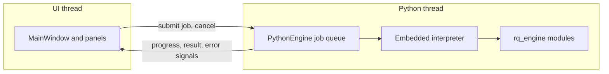

# Task 0: native application foundation, audit and plan

**Date:** 6 November 2026. **Audited:** `main` at `9f19ed8` and this Windows PC. **Status: a plan only. No native code exists, nothing was installed, and nothing has been built or run.**

Labels: **[Verified]** checked directly. **[Docs]** read in official documentation, not tried here. **[Unknown]** not established.

## Summary

- **The plan is feasible, but it is blocked until build tools are installed.** This PC has no C++ compiler, Windows SDK, CMake or Qt.
- **Recommended stack:** Qt 6.12 Widgets, MSVC 2022 x64, CMake and Ninja, pybind11, and a private copy of Python 3.13 embedded in the app.
- **All Python runs on one dedicated background thread,** so the window cannot freeze while Python works.
- **The browser terminal stays exactly as it is.** The native app goes in a new `native/` folder and touches no existing files.
- **Main risk accepted with embedded Python:** a crash inside a native Python library closes the whole app. Python exceptions are handled safely, but native crashes cannot be. Section 5 explains how to limit this.
- **Licence constraint:** the free Qt licence rules out several modules and needs dynamic linking and notices.

## 1. Repository audit

### Current state [Verified]

| Item | Finding |
| --- | --- |
| `main` | `9f19ed8`, with history, CSV export and the restart notice merged |
| Native code | None: no C++, QML, or CMake files |
| Branch protection on `main` | None |
| Deployment | GitHub Pages hosts only the summary site in `site/`. Nothing is deployed on Render |
| Test suites on the latest merge | Unit 72 of 72, launcher 9 of 9, browser 67 of 67. The 10-minute idle was not rerun; its frame gap and memory checks remain open |

### Open pull requests [Verified]

Both are drafts, and neither is touched by this plan.

| Pull request | State | Effect on this plan |
| --- | --- | --- |
| [#6 Render deployment](https://github.com/subashgauchan16/Resolute-Quant/pull/6) | **Conflicts with `main` in `server.py`** | None directly. Provider-terms questions remain open |
| [#7 Research models](https://github.com/subashgauchan16/Resolute-Quant/pull/7) | Owner confirms it is on hold | None. It should not be merged or built on. Its CI workflow exists only on that branch |

The other branches are already merged, and could be deleted when convenient.

### Launcher [Verified]

`Start Terminal.bat` creates `.venv` beside itself, installs `requirements.txt`, and runs `server.py`. **It is not changed by this plan.**

## 2. Windows environment [Verified on this PC]

| Item | Found | Needed |
| --- | --- | --- |
| Windows | 11 Home, x64, Intel Core Ultra 5 226V, 15.6 GB RAM | Enough for this task. Larger builds may be slow |
| Free disk | 79 GB | Enough. Exact install size [Unknown] |
| MSVC compiler | **None.** Only runtimes are installed | **MSVC 2022** |
| Windows SDK | **None** | **Required** |
| CMake, Ninja | **None** | **Required** |
| Qt | **None** | **Qt 6.12 MSVC 2022 x64** |
| Python | 3.13.14 from the Microsoft Store, with headers and libs. uv-managed 3.11, 3.12 and 3.14 | A private Python 3.13 for the app |
| `winget` | 1.29 | Can install the build tools |
| Long paths | **Disabled** | Keep paths short. Changing this setting is not needed |

### Versions checked [Verified]

| Tool | Available | Licence |
| --- | --- | --- |
| VS Build Tools 2022 | 17.14.44 on winget | Proprietary. **Check its licence fits your use** |
| CMake | 4.4.4 on winget | BSD-3-Clause |
| Ninja | 1.13.2 on winget | Apache-2.0 |
| Qt | 6.12.0 on the official mirror | LGPLv3, GPL or commercial |
| pybind11 | 3.1.0, supports CPython 3.9+ | BSD-style, per its licence file. GitHub does not auto-detect it |
| Python embeddable | 3.13.14 is available. 3.13.18 is the newest folder, with binaries [Unknown] | PSF |

### Why these choices

- **Qt 6.12, not 6.8 LTS.** [Docs] Qt lists 6.8's latest patch as commercial only, and limits immediate LTS access to commercial customers. [Docs] Qt 6.12 supports Windows 11 x64 with MSVC 2022.
- **Python 3.13.** The terminal's pinned packages were tested on it. Python 3.14 has not been tested with them.
- **Not the Store Python for the app.** It lives in a protected folder and updates itself, which works against repeatable builds. It stays in use for the browser terminal.

## 3. Application structure

### Directory layout

```text
native/
  CMakeLists.txt
  CMakePresets.json          exact build settings
  dependencies.lock.md       pinned versions, sources and checksums
  src/
    main.cpp                 entry point
    app/MainWindow.*         window, navigation, status bar
    app/HealthPanel.*        Python health panel
    bridge/PythonEngine.*    owns Python on its own thread
    bridge/PythonResult.h    plain C++ result types, with no Python types
  python/rq_engine/
    health.py                reports the interpreter state
    calculations.py          the numerical demonstration
  tests/
  README.md                  build instructions
```

Build output and the private Python go in `native/build/` and `native/runtime/`, both ignored by Git.

### Interface: Qt Widgets [Recommended]

| | Qt Widgets | Qt Quick / QML |
| --- | --- | --- |
| Dense tables and forms | **Strong, and built in** | More work |
| Languages to learn | **C++ only** | C++ and QML |
| Testing | **Simple with Qt Test** | Harder |
| Licence questions | **Fewer** | Qt lists Qt Qml Compiler and Quick 3D as GPL. A forum discussion also raises a static-linking question for QML builtins [Unknown] |
| Modern animated visuals | Limited | **Stronger** |

A terminal is mostly tables and panels, and you are still building C++ experience, so Widgets is the simpler base. **This is a decision for you.** Moving later would mean rewriting screens, but not the Python bridge.

### Dependency strategy

- **pybind11:** fetched by CMake at a pinned version and checksum.
- **Qt:** installed to `C:\Qt` at an exact version, linked **dynamically**, and limited to `Core`, `Gui`, `Widgets` and `Test`.
- **Python packages:** `numpy` only for now, pinned, and installed into `native/runtime/` rather than system-wide.
- **Avoid under the free Qt licence:** Qt Charts, Qt Graphs, Qt Quick 3D, Qt HTTP Server, Qt gRPC and static linking. If a chart is needed later, the options are in the Phase 0 audit.

### Licence duties when distributing

**[Docs]** A closed-source app may use Qt under LGPLv3 if it meets its terms. These include giving users the LGPL text and a prominent notice, and letting them relink against a modified Qt. **Building and running on your own PC does not trigger distribution duties. Get legal advice before shipping to others.**

Sources: [Qt obligations](https://www.qt.io/development/open-source-lgpl-obligations), [Qt licensing FAQ](https://www.qt.io/faq/qt-open-source-licensing), [Qt licensing](https://doc.qt.io/qt-6/licensing.html), [Qt supported platforms](https://doc.qt.io/qt-6/supported-platforms.html), [Qt releases](https://doc.qt.io/qt-6/qt-releases.html).

## 4. C++ and Python bridge

### pybind11 or the raw Python C API

| | pybind11 (recommended) | Python C API |
| --- | --- | --- |
| Reference counting | **Automatic** | Manual, and a common source of crashes |
| Python errors to C++ | **Become C++ exceptions** | Checked after each call |
| Code to write | **Small** | Much larger |
| Dependency | Headers only | None |

**The bridge has one rule: no Python types cross it.** The window only sees plain C++ results. All Python-specific code stays in `bridge/`.



### Interpreter lifecycle

| Stage | Behaviour |
| --- | --- |
| **Start** | The app starts its Python thread, which sets up an isolated interpreter using only `native/runtime/`. It ignores `PYTHONHOME`, user packages and system Python |
| **Failure to start** | The window still opens, and the health panel names the problem, such as a missing runtime folder |
| **Run** | One job at a time on one thread, with the rest queued. The GIL is released while the queue is idle |
| **Restart** | **Never within a process.** [Docs] pybind11 warns that restarting may be unsafe for third-party extensions |
| **Stop** | New jobs are refused, cancel is signalled, the job gets a short grace period, and the interpreter shuts down on its own thread |

Signal handlers stay with Qt, so Python does not take over Ctrl+C.

### Error propagation

| Failure | What happens | User sees |
| --- | --- | --- |
| Python exception | Caught on the Python thread and returned as a result with type, message and traceback | A plain message, with details expandable |
| Bad input, such as an empty list | Python raises `ValueError` | The validation message |
| Missing package | `ImportError` at the health check | Which package is missing |
| Job cancelled | Returned as cancelled, not as failed | "Cancelled" |
| Job stuck in a native call | Cannot be interrupted. See shutdown below | "Still stopping" |
| **Native crash** | **Cannot be caught, and the app closes** | Nothing inside the app. See below |

Errors are also written to a local log file. **Logs must never contain API keys or credentials.**

## 5. Long-running work and shutdown

- **Non-blocking:** the UI thread only queues jobs and receives results through Qt queued signals. It never waits on Python.
- **Progress and cancel:** Python jobs call a small helper to report progress and check for cancellation. This is cooperative.
- **Parallelism:** one Python thread means one job at a time. Later, heavy work can move to separate processes without changing the UI interface.
- **Shutdown:** the app waits a short, fixed time for a cooperative job. If native code still will not stop, the app logs it and ends the process, because waiting forever would be worse. The test suite must confirm this.

### The main trade-off

The Phase 0 audit recommended a separate Python process, because a crash would not take down the window. You have chosen embedding, and it is workable. Its benefits are direct in-memory data exchange and a single application. Its costs are:

- **A native crash closes the app,** for example in NumPy, a machine-learning library or an out-of-memory failure.
- **One GIL:** CPU-heavy Python work doesn't run in parallel with other Python code.
- **Packaging** must match Python and library versions exactly.

**Mitigation:** keep every call behind `PythonEngine`. Risky work, such as model training, can later run in a child process launched from the embedded Python, without changing any screens. Task 0 proves the embedded path only.

## 6. Minimal application (to build after approval)

- **Window:** a charcoal, gold and silver theme, sidebar navigation with Home and Python Health, and a status bar. It shows the existing logo only if that is straightforward.
- **Health panel:** Python version and path, whether isolation is active, NumPy version, and a **Run health check** button.
- **Numerical demonstration:** enter a list of numbers, and Python returns the mean and standard deviation calculated with NumPy, shown in Qt. **This is a calculation demonstration and not a model.**
- **Responsiveness demonstration:** a job running for several seconds, with progress, **Cancel**, and a moving UI heartbeat to show the window stays live.
- **Error demonstration:** invalid input shows the Python error in the panel.

**SQLite is not in the first build.** Nothing here needs it yet, so it would be unused code. I propose adding it in the next task, through Qt's SQL module, for settings and provenance.

## 7. Tests planned

**None of these exist yet.**

| Test | What it proves |
| --- | --- |
| Bridge | Known inputs give the expected results, checked against values calculated independently in C++ |
| Error propagation | A Python exception returns type, message and traceback, and the next job still works |
| Isolation | `sys.flags.isolated` is set, and only `native/runtime/` is on the path |
| Startup and shutdown | Repeated launches in `--smoke-test` mode exit with code 0, leaving no process behind |
| Missing runtime | A missing Python folder gives a clear message and no crash |
| Responsiveness | During a long job, the UI thread's largest stall stays under a limit we set before measuring |
| Cancel and queue | Cancel ends a job, and queued jobs run in order |
| UI smoke | Qt's offscreen mode opens the window and runs a calculation end to end |
| Clean folder | A copy deployed with `windeployqt` runs from a folder outside the build tree |
| Regression | The existing unit, launcher and browser suites still pass |

Tests run through `ctest`. GitHub Actions could be added later, once the local build is stable.

## 8. Coexistence

| Component | During this task |
| --- | --- |
| Browser terminal and `Start Terminal.bat` | **Unchanged, and still the working product** |
| `server.py` and `crypto_feed.py` | Unchanged, and not used by the first native build |
| Project website | Unchanged |
| Render ([#6](https://github.com/subashgauchan16/Resolute-Quant/pull/6)) | Unaffected. The native app is a desktop program and cannot deploy to Render. A hosted web version would stay browser-based, under the provider-terms questions already raised |
| Ports | The native app opens none |

**Later:** `history.py` and the validation in `crypto_feed.py` can be imported directly by the embedded Python, since they have no web dependency. Running the browser terminal and the native app together could open two Coinbase connections, so that needs handling when market data arrives.

## 9. Future extension points

Designed for, but **not built in this task:**

| Future feature | Where it plugs in | Open question |
| --- | --- | --- |
| Company and supplier graph | SQLite schema, `rq_engine` module, new screen | Data sources and their terms |
| Live report and disclosure ingestion | Background jobs with progress and cancel | Source terms, document storage |
| Forecasting | `rq_engine` module, ideally in a child process | **Blocked on permitted data and agreed thresholds** |
| Procurement integrations | A new service layer, with credentials in Windows Credential Manager | Customer authorisation and security review |
| Market data in native | `rq_engine` reusing the current Python | Provider terms |

## 10. Acceptance criteria status

| Criterion | Status |
| --- | --- |
| Builds and launches on Windows | **Not started: blocked on tools** |
| Embedded Python starts | Not started |
| Calculation result appears in Qt | Not started |
| Exceptions shown with diagnostics | Not started |
| Long tasks do not freeze the UI | Not started |
| Clean shutdown | Not started |
| Tests and build instructions, reported accurately | Not started; this document is the plan |
| Existing functionality and pull requests preserved | **Met so far:** documentation only |
| No credentials committed | **Met so far:** none exist or are needed |

## 11. Implementation stages after approval

| Stage | Work | Effort | Done when |
| --- | --- | --- | --- |
| 1 | Install tools, and record exact versions | S | A sample C++ and Qt program compiles |
| 2 | CMake project and empty window | S | The window opens from a clean build |
| 3 | Private Python and `PythonEngine` | M, **the riskiest** | The health check returns from Python in the UI |
| 4 | Numerical, error and long-running demonstrations | M | Each works, with its test |
| 5 | Shutdown, missing-runtime and clean-folder tests | M | All pass repeatedly |
| 6 | Build instructions, followed from scratch | S | A second clean build works from the document |

Each stage is a separate reviewable commit on one pull request. If a stage reveals a blocker, work stops and I report it.

## 12. Decisions and blockers

**Blocked until you approve:**

1. **Installing the tools.** Installers change the system and need your approval on a Windows admin prompt. Their licence terms are yours to accept.

```bash
winget install --id Microsoft.VisualStudio.2022.BuildTools --exact --override "--passive --wait --add Microsoft.VisualStudio.Workload.VCTools --includeRecommended"
```

```bash
winget install --id Kitware.CMake --exact
```

```bash
winget install --id Ninja-build.Ninja --exact
```

2. **How to get Qt.**
   - **Official online installer:** needs a free Qt account, which you would create yourself.
   - **`aqtinstall`:** MIT licensed and scriptable with no account, downloading from Qt's mirrors, but it is not an official Qt tool.
   - **I recommend the official installer** for a first setup, since it is the supported route.

**Your choices, with my recommendation first:**

3. Qt Widgets, or Qt Quick.
4. Accept the embedded-Python crash trade-off in section 5.
5. Build Tools only, or full Visual Studio Community if you want an editor and debugger. Community gives you a much better way to learn and debug C++, but is a larger install.
6. Close draft #7, since it was a mistake. It can stay open until you decide.

**Not verified:**

- Whether the Python 3.13 runtime and development files can be sourced cleanly. The NuGet package for 3.13.14 was not found at the URL I tried, so stage 3 starts by confirming the source.
- Whether pinned NumPy loads and shuts down cleanly in an embedded interpreter. Only a real build can show this.
- Whether interpreter shutdown is reliable on a non-main thread with NumPy loaded. This is the first thing stage 3 tests.
- Install sizes and build times on this PC.
